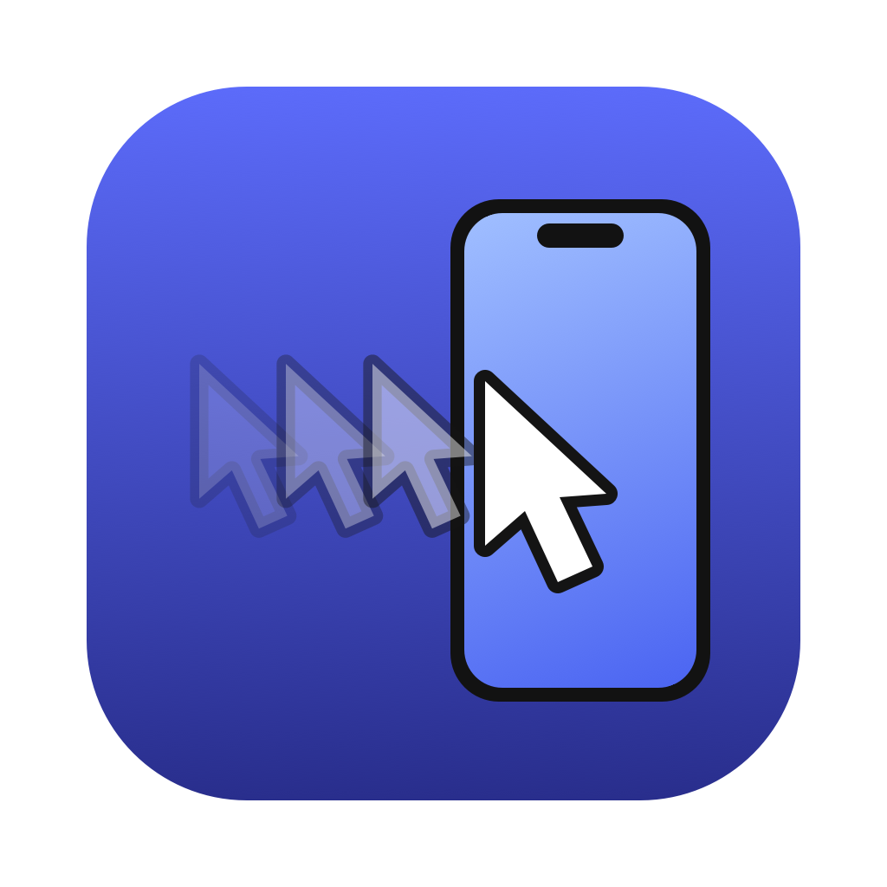
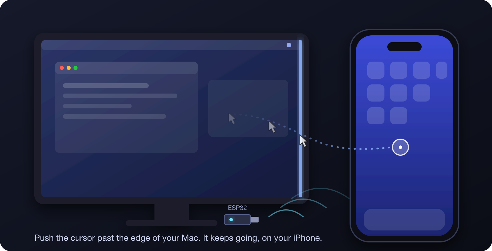
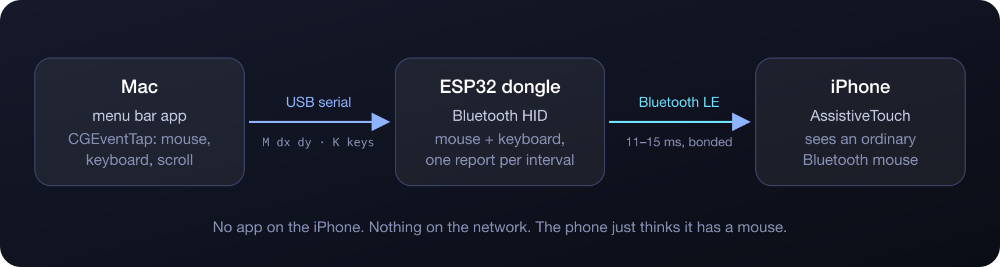
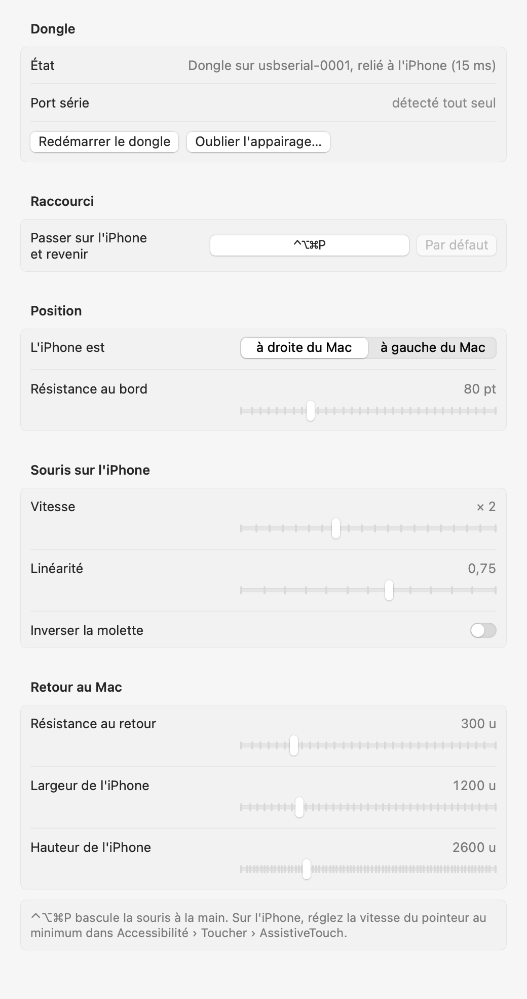

<div align="center">



# Glisse

**Your Mac's mouse and keyboard, on your iPhone.**
Push the cursor past the edge of the screen: it keeps going on the iPhone next to it. Push it back, and it's home.




https://github.com/user-attachments/assets/2d3c361e-b732-4452-a744-62e2ec992f78

<sub><b>Past the Edge</b>: the 20-second film. A cursor, a very small dongle and a bad idea. Sound on.</sub>

</div>

Glisse is a free, open-source take on **Universal Control for the iPhone**. Apple only does it with an iPad, and
an iOS app can't drive the rest of the phone, so Glisse goes through hardware: a **$5 ESP32 board** plugged into
the Mac's USB port pretends to be a **Bluetooth mouse and keyboard** for the iPhone, and a small **menu bar app**
feeds it your real mouse and keyboard whenever the cursor is "on the iPhone". No app to install on the phone,
nothing on the network: the iPhone just thinks it has a mouse.

- **Mouse**: move, left, right, middle, back and forward buttons, vertical and horizontal scroll.
- **Keyboard**: type on the iPhone while the cursor is there (letters, digits, punctuation, arrows, ⌘ ⌥ ⌃ ⇧,
  function keys); keys go back to the Mac the moment the cursor does.
- **Smooth**: the dongle sends one HID report per Bluetooth connection interval (11–15 ms on iOS), with a
  response curve that evens out the double acceleration (macOS, then iOS).
- **Safe**: while the mouse is on the iPhone the Mac's cursor is frozen and hidden, and nothing leaks to the Mac.
- **Hands off**: unplug the dongle or walk away with the phone, the Mac takes the mouse back by itself.

<p align="center">
  
</p>

## What you need

| | |
| --- | --- |
| **A Mac** | macOS 14 or later, Xcode 16 or the Command Line Tools (Swift 5.10). |
| **An ESP32 board** | Any ESP32 with Bluetooth: a classic ESP32 dev kit (WROOM), an ESP32-S3 or an ESP32-C3. Not the S2 (no Bluetooth). Around $5. |
| **An iPhone** | iOS 13 or later: Glisse uses the system's AssistiveTouch mouse support, nothing else. An iPad works the same way. |
| **A cable** | The board stays plugged into the Mac. |

## Install

### 1. Flash the dongle

```sh
brew install arduino-cli
arduino-cli config add board_manager.additional_urls https://espressif.github.io/arduino-esp32/package_esp32_index.json
arduino-cli core update-index && arduino-cli core install esp32:esp32
arduino-cli lib install NimBLE-Arduino

git clone https://github.com/Snouzy/glisse.git
cd glisse/firmware
make upload                 # BOARD=classic by default; BOARD=s3 or BOARD=c3 for those chips
```

The port is detected (`/dev/cu.usbserial*`, `usbmodem*`…); pass `PORT=/dev/cu.xxx` if you have several.
`make monitor` opens the serial monitor: type `?` to get `glisse 0.2 paired 0 connected 0 interval 15`.

> On an Apple Silicon Mac without Rosetta, the `ctags` tool Arduino ships is x86-only. `brew install ctags`, then
> replace `~/Library/Arduino15/packages/builtin/tools/ctags/5.8-arduino11/ctags` with a symlink to
> `/opt/homebrew/bin/ctags`.

### 2. Pair the iPhone

Settings › Accessibility › Touch › **AssistiveTouch**: turn it on, then **Devices › Bluetooth Devices › Glisse**.
No code to type. In the same screen, set the **pointer speed to the minimum**: the Mac estimates where the iOS
pointer is, and iOS's own acceleration makes the estimate drift. For a pointer you can actually see, go to
Accessibility › **Pointer Control**: increase contrast, pick a color, make it bigger, and turn off auto-hide.

### 3. Install the Mac app

```sh
cd ../mac
./scripts/install.sh        # builds Glisse.app, copies it to ~/Applications and launches it
```

macOS asks for the **Accessibility** permission: Glisse needs it to read the mouse and keyboard and to hold them
back while they are on the iPhone. An iPhone icon appears in the menu bar: crossed out without the dongle, with an
exclamation mark until the iPhone is connected, plain when ready.

`scripts/build-app.sh` signs with your *Developer ID Application* certificate when one is in the keychain, and ad
hoc otherwise (macOS then forgets the permission after each rebuild).

## Use it

- **Go**: push the cursor against the edge of the screen (right by default). After a short resistance it is on the
  iPhone; the Mac's cursor stays parked and hidden at the edge.
- **Click, scroll, type**: everything goes to the iPhone. A right click opens the AssistiveTouch menu.
- **Come back**: push the pointer against the Mac side of the iPhone, or press the shortcut (**⌃⌥⌘P** by default)
  from anywhere. The shortcut also sends the cursor over from wherever it is, and brings it back to the same spot.
- **Lose the dongle or the phone**: the Mac takes the mouse back on its own.

If another Mac or an iPad is linked with Universal Control, it claims a screen edge too, and wins: macOS handles
it before Glisse sees anything. In System Settings › Displays, put that device on the side opposite the iPhone,
and under Advanced… turn off *Automatically reconnect to any nearby Mac or iPad*.

## Settings

Menu › **Settings…** (⌘,). Every change applies immediately.

<p align="center">
  <picture>
    <source media="(prefers-color-scheme: dark)" srcset="docs/images/settings-dark.png">
    
  </picture>
</p>

| Setting | What it does |
| --- | --- |
| **Shortcut** | Click the button, press the combination you want. It needs ⌃, ⌥ or ⌘ (or a function key); Esc cancels. |
| **iPhone side** | Left or right of the Mac. |
| **Edge resistance** | How hard to push against the edge before crossing, so you don't fall onto the iPhone by accident. |
| **Speed** | Mouse units sent to the iPhone per point moved on the Mac. |
| **Linearity** | At 1 the motion is proportional. Below, small moves are amplified and big ones held back, to compensate for the acceleration iOS adds on top of macOS's. 0.75 by default. |
| **Invert scroll** | For the wheel direction you expect on the phone. |
| **Return resistance** | How far to push against the Mac side of the iPhone before coming back. Absorbs the gap between the estimated pointer and the real one. |
| **iPhone width / height** | What the pointer travels from edge to edge, in mouse units. Too small and you come back to the Mac too early; too big and you cross the phone several times. |
| **Serial port** | Leave empty to pick the first USB serial port. |
| **Restart the dongle** | Pulses the board's reset line through the serial port. Handy when the iPhone forgot Glisse and the dongle still thinks it is connected. Pairing is kept. |
| **Forget pairing** | Clears the dongle's Bluetooth bonds, after a confirmation. Then forget Glisse on the iPhone and pair again. |

The app's interface is in French for now; English strings are a welcome contribution.

## How it holds together

- iOS never reports where its pointer is. Glisse integrates the deltas on a virtual rectangle the size of the
  iPhone and **pins the real pointer to the edge** when you enter and when you push against the Mac side, so the two
  resync at every crossing. The shortcut is the fallback that never misses.
- macOS's mouse/cursor dissociation (`CGAssociateMouseAndMouseCursorPosition`) does not hold for a background app, so
  while the mouse is on the iPhone Glisse **re-parks the cursor on every event**, like Synergy does, and reads the
  event's deltas instead of its position.
- The cursor is hidden with SkyLight's private `SetsCursorInBackground` property (the one Synergy and Barrier
  use), and an invisible panel sits under the parked cursor as a last net for stray clicks.
- The firmware is written straight on **NimBLE**: a composite HID report map (report 1 mouse with five buttons,
  X/Y, wheel and AC pan; report 2 a standard six-key keyboard), Just Works bonding, a requested connection interval
  of 11.25–15 ms, and **one mouse report per negotiated interval**, with deltas accumulated and the remainder carried
  over, instead of one notification per event.
- The Mac talks to the dongle over USB serial at 115200 with a text protocol you can type in a serial monitor:
  `M dx dy` move, `S dz dh` scroll, `B mask` buttons, `K mods k1…k6` keyboard, `R` release all, `?` status, `!` forget
  bonds.

## Development

```sh
cd mac
swift test                  # GlisseCore: wire protocol, edge guard, virtual cursor, response curve, key map, hotkey
./scripts/install.sh        # rebuild and relaunch the app
./scripts/screenshots.sh    # re-render the README images off screen (settings from the real SwiftUI view, SVG illustrations)
swift scripts/make-icon.swift   # redraw the app icon

cd ../firmware
make compile && make upload # BOARD=classic|s3|c3
```

- `mac/Sources/GlisseCore`: everything testable without a screen (serial protocol, edge crossing, the virtual
  pointer on the iPhone, response curve, macOS key code → HID usage map, hotkey matching).
- `mac/Sources/GlisseApp`: the menu bar app (CGEventTap, serial port, controller state machine, cursor hiding,
  settings window).
- `firmware/glisse/dongle.cpp`: the dongle. The `.ino` is a stub because Arduino's prototype generator mangles
  static functions.

## FAQ

**Can I use my Mac's mouse and keyboard on my iPhone, like Universal Control?**
Yes, that is what Glisse does. Apple's Universal Control only pairs a Mac with an iPad or another Mac; Glisse adds
the iPhone by making a tiny ESP32 board behave as a Bluetooth mouse and keyboard the phone already knows how to use.

**Do I need to jailbreak or install anything on the iPhone?**
No. iOS has supported Bluetooth mice since iOS 13 through AssistiveTouch. Glisse only uses that.

**Why a dongle? Can't the Mac be the Bluetooth mouse itself?**
macOS cannot act as a Bluetooth HID peripheral; it is always the host. A $5 board can.

**Does it work with an iPad?**
Yes, the same way. If the iPad is also linked with Universal Control, give each a different edge.

**Is the pointer position exact?**
No: iOS never tells where its pointer is. The Mac estimates it, pins it to the edge at each crossing and keeps a
return resistance so the mouse doesn't come back by surprise. The shortcut always brings it back.

**Does anything leave my computer?**
No. Nothing goes on the network. The Mac talks to the dongle over a USB cable, the dongle talks to the iPhone
over Bluetooth.

## License

[MIT](LICENSE)

---

<details>
<summary><strong>En français</strong></summary>

Glisse fait passer la souris et le clavier du Mac sur l'iPhone posé à côté, comme Universal Control le fait
avec un iPad. Pousse le curseur contre le bord de l'écran : il continue sur l'iPhone, avec les clics, la molette,
les boutons latéraux et le clavier. Ramène-le par le même bord, ou avec le raccourci (⌃⌥⌘P par défaut).

Rien à installer sur l'iPhone : une carte ESP32 à 5 € branchée en USB au Mac se fait passer pour une souris et un
clavier Bluetooth (AssistiveTouch), et une app dans la barre des menus lui envoie la vraie souris quand le curseur
est « sur l'iPhone ». Rien ne passe par le réseau.

- **Montage** : flasher la carte (`cd firmware && make upload`), appairer l'iPhone dans Réglages › Accessibilité ›
  Toucher › AssistiveTouch › Appareils › Appareils Bluetooth, mettre la vitesse du pointeur au minimum, puis
  `cd mac && ./scripts/install.sh`. macOS demande l'accès Accessibilité.
- **Réglages** (⌘,) : raccourci (clique, appuie la combinaison), côté de l'iPhone, résistance au bord, vitesse,
  linéarité (compense l'accélération d'iOS), molette inversée, résistance au retour, taille de l'iPhone en unités,
  port série, redémarrer le dongle, oublier l'appairage (avec confirmation).
- **Universal Control** : si un autre Mac ou un iPad prend un bord, range-le du côté opposé dans Réglages Système
  › Écrans, et décoche la reconnexion automatique.
- **Limite** : iOS ne dit pas où est son curseur ; le retour par le bord est une estimation recalée à chaque
  passage. Le raccourci ramène toujours la souris.

Tests : `swift test` dans `mac/`. Licence MIT.

</details>
